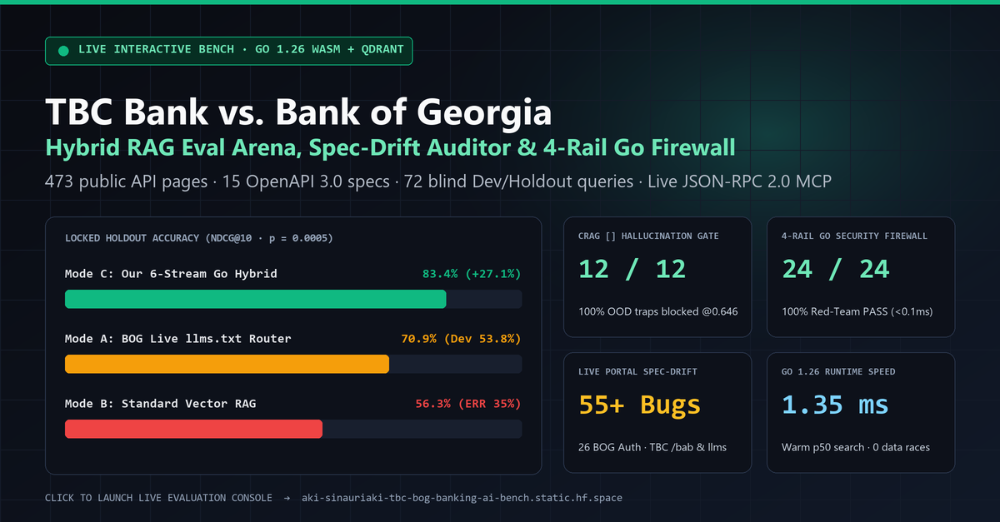

  
    
  
  
  

---

# TBC Bank vs. Bank of Georgia — Developer AI Portal Bench, Spec-Drift Auditor & 4-Rail Go MCP Firewall

An empirical retrieval evaluation workbench, concurrent OpenAPI spec-drift scanner, `<0.1 ms` 4-rail banking security guardrail, and dual-transport **Model Context Protocol (MCP)** server built on **100% public developer portal documentation and OpenAPI 3.0 specifications** from **Bank of Georgia (`api.bog.ge`)** and **TBC Bank (`developers.tbcbank.ge`)**.

> **Live Zero-Login Console (Compiled Go 1.26 WebAssembly):**  
> 👉 **https://aki-sinauriaki-tbc-bog-banking-ai-bench.static.hf.space**

---

## 1. Locked Holdout Benchmark Results (`72` Blind Queries: `36` Dev / `36` Locked Holdout)

Dual-judge relevance pool (`4,274` query-chunk pairs across `1,294` heading-bounded chunks) validated at **Cohen's $\kappa = 0.7758$** (weighted $\kappa_w = 0.8387$). Full verified telemetry in [`artifacts/discovery_report.json`](artifacts/discovery_report.json).

| Retrieval Architecture | Holdout NDCG@10 | Holdout MRR@10 | Exact Symbol (`SYM`) | Error Lookup (`ERR`) | Scope Traps (`CTX`) | Cross-Bank Leaks | Out-of-Domain Abstention (`[]`) | Warm `p50` |
| :--- | :---: | :---: | :---: | :---: | :---: | :---: | :---: | :---: |
| **Mode B: Standard Vector RAG** (`MiniLM` Raw) | `56.3%` | `59.9%` | `85.0%` | `35.0%` | `46.0%` | `2` | `0 / 6 (0%)` | `0.29 ms` |
| **Mode A: BOG Live `llms.txt` Index Router** | `70.9%` (`53.8%` Dev) | `75.7%` | `86.0%` | `55.0%` | `72.0%` | `2` | `0 / 6 (0%)` | `0.50 ms` |
| **Mode C: Our 6-Stream Banking Hybrid (`Go + Qdrant`)** | **`83.4%`** | **`89.4%`** | **`96.0%`** | **`64.0%`** | **`91.0%`** | **`0`** | **`6 / 6 (100%)`** | **`1.35 ms`** |

- **Paired Bootstrap Significance (2,000 resamples on Locked Holdout):**
  - **`+27.1%` NDCG@10** over Standard Vector RAG ($p = 0.0005$)
  - **`+12.5%` Holdout / `+25.6%` Dev** over BOG's live `llms.txt` router ($p = 0.0005$)
  - **`12 / 12 (100%)` OOD Hallucination Abstention (`[]`)** across Dev + Holdout at calibrated CRAG threshold `0.646` (`0` false abstentions).

---

## 2. Live Portal Hazards Discovered Automatically (`13.54 ms` Concurrent Go Scan)

Full structured output in [`artifacts/xray_diagnostic_report.json`](artifacts/xray_diagnostic_report.json):

### Bank of Georgia (`api.bog.ge` — `240` Public Records / `596` Chunks)
1. **26 Same-Page `Basic` vs `Bearer` Auth Contradictions:** Across 26 Payment Manager & Sandbox pages, the parameter table lists `Authorization: Basic <base64> (required)` while adjacent prose and `curl` snippets require `Authorization: Bearer <jwt_token>`.
2. **11 Deprecated Endpoints (`⚠️(Deprecated)`) Active in `llms-full.txt`:** Retired endpoints remain bundled inside the active AI feed.
3. **152 Commercial API Pages Missing OpenAPI YAML in `llms.txt`:** OpenAPI specs cover Open Banking only, and `15/40` operations in `openbanking.yaml` v0.8 omit `4xx` error schemas.

### TBC Bank (`developers.tbcbank.ge` — `233` Unique Records / `698` Chunks)
1. **Missing `/llms.txt` (`404`) + 50 Duplicate Sidebar Redirects:** Deduplicated all 50 redirect loops and generated TBC Bank's complete, clean **`llms.txt`** -> [`artifacts/tbc_generated_llms.txt`](artifacts/tbc_generated_llms.txt).
2. **Guide-vs-OpenAPI Path-Prefix Drift:** Prose guides cite `/v1/accounts/...` and `/oauth/authorize` while OpenAPI `/reference` specs require `/bab/v1/accounts/...` and `/psd2/openbanking/oauth/...`.
3. **Literal Trailing-Space Bug in OpenAPI Spec:** `tbc-id-oauth-token` path key is literally `"POST /openbanking/oauth/token "` (with a trailing space), plus `12` endpoints omit `4xx` schemas and `6/12` callback pages omit signature verification guidance.

---

## 3. Pure-Go 4-Rail Banking Security Firewall & Dual-Transport MCP Server

- **Rail 1 (Privacy & Secrets):** Scrubs Georgian IBANs (`GE..TB` / `GE..BG`), 16-digit Visa/Mastercard PANs, Bearer JWTs, and `client_secret`s in `<0.1 ms` (guaranteed $O(n)$ Thompson NFA — zero ReDoS).
- **Rail 2 (Prompt Injection Defense):** Blocks system-prompt extraction and cross-tenant data pivots.
- **Rail 3 (OpenAPI Contract Verifier):** Catches BOG's `Basic/Bearer` conflict, TBC's `/bab/v1` and `/psd2/openbanking` drift, trailing-space paths, and retired endpoints.
- **Rail 4 (Payment Callback & Redirect Integrity):** Blocks insecure `?status=success` browser-redirect verification in favor of server-to-server order checks.
- **24-Vector Concurrent Red-Team Suite:** **`24 / 24 (100% PASS)` in `1.00 ms`** (`0` data races under `go test -race ./...`).
- **Dual-Transport MCP Server:** JSON-RPC 2.0 over `stdio`, HTTP `POST /api/mcp`, and browser WebAssembly.

---

> **Source Code & Technical Walkthrough Notice:**  
> This public showcase repository publishes the live compiled Go 1.26 WebAssembly deployment, full statistical evaluation artifacts, live spec-drift findings, and TBC Bank's generated `llms.txt`. The private Go 1.26 engine & 6-Step Discovery Lab source code is available for live walkthrough during technical interviews — contact **[Archil (Aki) Sinauridze on LinkedIn](https://www.linkedin.com/in/archil-sinauridze-0b874b3ba/)**.
